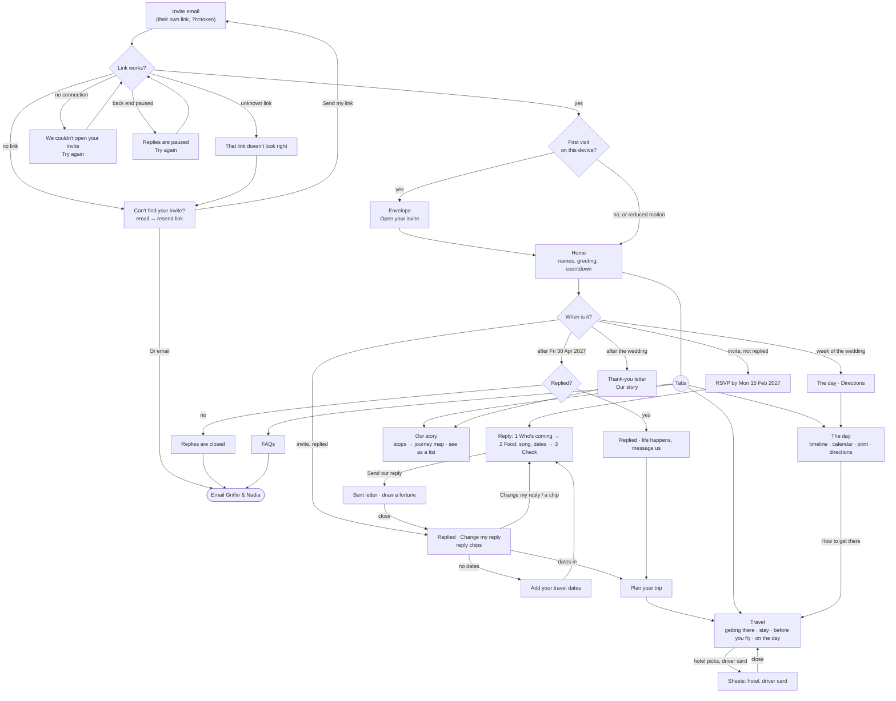

# Guest journey map

How a guest moves through the site, from the invite email to after the wedding, and where the path stops with
nowhere to go (dead ends). Checked against the code on 18 Oct 2026 (run 18e). Words in quotes are the site's own.

## Dead ends

| Where | What happened | Status |
|---|---|---|
| Home after Fri 30 Apr, not replied | "Replies are closed now. If something's changed, message Griffin or Nadia." but no way to message them | **Fixed (18e):** an "Email Griffin & Nadia" link under it (`mailto:` the wedding address the no-invite page already uses; label in `pending.ts`) |
| End of FAQs | "Any questions at all, message either of us." with no link | **Fixed (18e):** the same email link after it |
| Home after replying | Replied, chips, then nothing pointing onwards | **Fixed (18e §8):** one next step, "Add your travel dates" or "Plan your trip" |
| No-invite pages (missing or unknown link) | After the frame went in (§5) the card lost its padding there | **Fixed (18e):** the same frame as every page |
| On the day, who to call | "call Jehan or Noya. We'll add their numbers closer to the time." | Waiting on N&G: the numbers (`contact.dayDetails` in `pending.ts` WAITING) |
| Last Travel section, last story stop | The end of the page | Fine: the tabs are always there (dock or bar) |
| Sealed envelope | Only one way on (open it) | Intended: any key, a tap, the label button or a pull all open it |
| Offline or paused | "Try again" only | Intended: nothing else would work without a connection |

Nothing found that traps a guest with no way back: the dock (phones) or the bar (laptops) is on every page past the
envelope, and every sheet closes with Escape, the close button or a tap outside.
