# Run 19: final touches

## Morning summary

Every section is merged, live and checked (the Pages deploy finished and the change is in the live files). Each PR's
gates passed before it merged.

| Section | What | PR |
|---|---|---|
| 0 | Blank-page safety net, the NAVITIME train link, the countdown maths | #172 |
| 1 | One card width, shorter pages, one grid for Our story, the QR card on every page | #175 |
| 2 | Travel taps land just under the tab row; opened rows glide into view only when needed | #179 |
| 3 | Arrival: the "Open your invite" note is back, one clear seal and open, faces clear of the envelope | #178 |
| 4 | The globe: smooth, see-through, every country, Kyoto's label, every line; every country in the city search | #176 |
| 5 | The fortune folds open like an omikuji, centred; songs two at most in the back end too | #177 |
| 6 | FAQs shorter and in their voice, a warmer Ask us | #171 |
| 6b | Names checked against Nadia's art and gated; Home's tags a 2x2 grid on phones | #180 |
| 7 | The seal-mark credit on laptops; none on Home on phones | #181 |
| 8 | Motion: one easing family, three durations, transform and opacity only; the theme circle | #182 |
| 9 | Lab: run by the lab session in parallel; nothing marked "Ready to ship" in docs/lab.md | (lab session) |
| 10 | Sheet tidy (report, then do it), To look at, Seen and Changed, Archive, docs/sheets.md | #174 |
| 11 | User-testing pass, docs/ux-test.md, three P1 fixes | #183 |
| Follow-ups | The flat map paints only on its own story stop; the crash card says "Ask us" | #184 |
| Log | This log | this PR |

Nothing from earlier runs was redone: none of this brief's items had been merged before.

**Apps Script:** pushed with `clasp push --force` from fresh `main` to the existing deployment twice, each checked
live with `?action=health` (ok): version 47 after #174 (the sheet tidy, the queue fixes, `?action=check` returns the
city) and version 48 after #177 (two songs at most). Every live action was then checked end to end on the test
households: 19 pass, 0 fail, 2 skipped (a first reply, as both test households have already replied; and the queued
"Send my link", which needs a test address in `RESEND_EMAIL`). Live journeys: `?action=journeys` answers
`{ ok, cities }` with 0 cities today (no coming household has given a city yet), so sample lines show only for the
sample household, the lab and previews.

**Before and after** (the first screen of every page, before on top, after below):

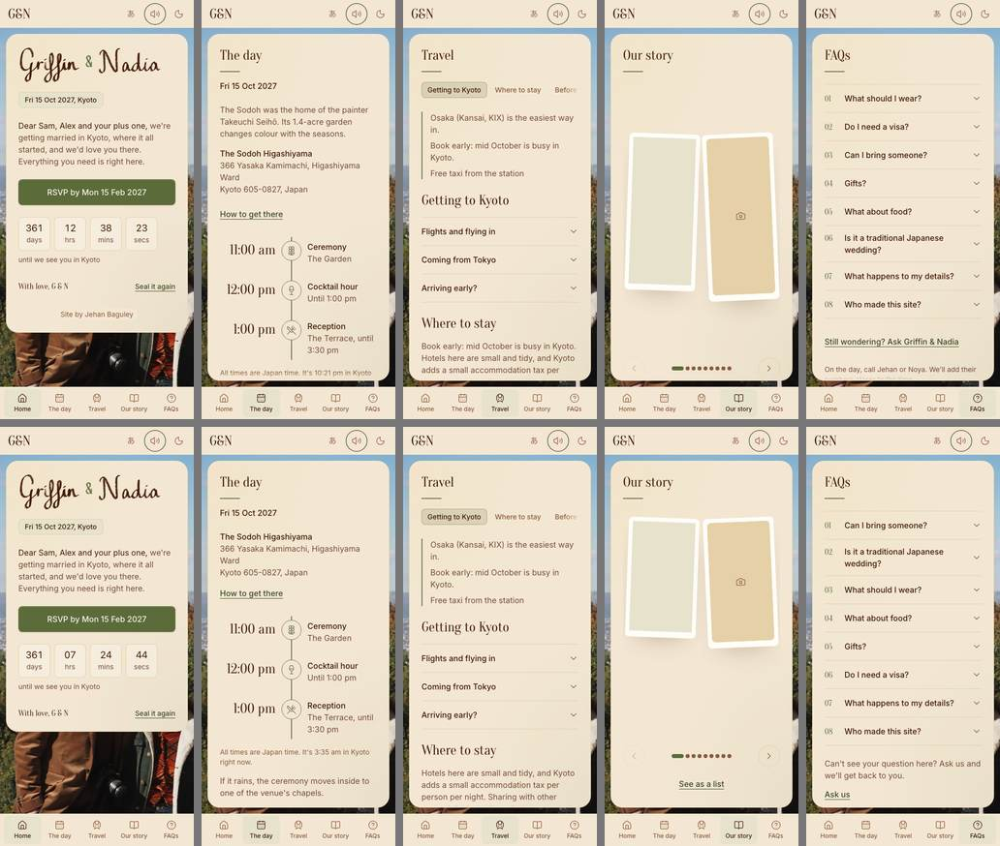
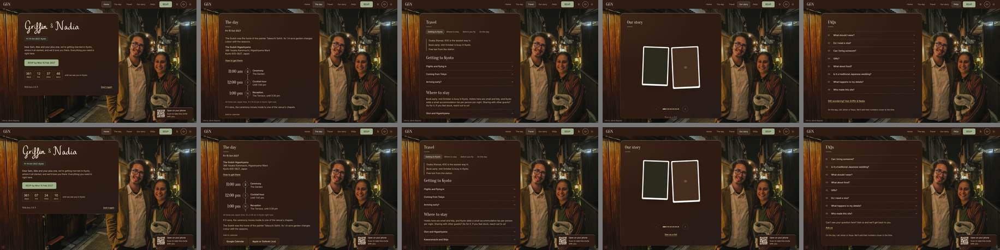

Card content height against the card's frame (px), sample household:

| Page | 390 before | 390 after | 1440 before | 1440 after |
|---|---|---|---|---|
| Home | 600 / 600 | 544 / 544 | 601 / 601 | 537 / 537 |
| The day | 1004 / 697 | 996 / 697 | 952 / 770 | 888 / 770 |
| Travel | 2309 / 697 | 2241 / 697 | 2286 / 770 | 2182 / 770 |
| Our story | 779 / 697 | 697 / 697 | 832 / 770 | 770 / 770 |
| FAQs | 729 / 697 | 781 / 697 | 770 / 770 | 770 / 770 |

The card is 740px wide on every page and sheet on laptops (gated at 1024, 1280, 1440 and 1920), and opening an FAQ no
longer changes it (it jumped from 588 to 740 between 768 and 1023). Home, The day, Our story and FAQs answer their
question on the first screen at both sizes; Travel's first screen is its tab row and the three summary lines, and the
rest is reference behind tabs and accordions. FAQs on a phone grew by the new two-line Ask us intro.

**Performance** (phone size, 4x slower CPU, motion on, medians of 5): no interaction has a long task over 50 ms,
before or after, and 0 to 1 dropped frames. Layouts per interaction: accordion 24 to 3, story swipe 11 to 3 (style
recalcs 446 to 61), envelope 71 to 61. The globe holds 60 fps through its intro, a drag, the glide and the turn back
(4x CPU); one 167 ms frame while it paints, before it shows. Initial JS is 130 kB gzipped (budget 150).

**Lab decisions waiting** (run `npm run lab`): the lab session ran its sections in parallel on its own PRs (#170, #173
and after). Nothing in docs/lab.md is marked "Ready to ship", so nothing from the lab went to the site in this run.
The G&N in Nadia's own lettering (section 7) and the story and globe looks (section 9) are there to judge, each with
its "Deciding:" line.

**UX test** ([docs/ux-test.md](../ux-test.md)): eight guests, nine tasks each, all finished, no console errors. No
P0. Three P1s fixed in #183: phone sheets ran 12px off the right edge (from #175's card width), most households got
"Thanks, got it" instead of "You're all set" (an unused plus one counted as not coming), and focus fell to the page
after "Back to your invite". P2: a Japanese phone starts in English (held until the Japanese read), the music button
reads "Pause music, selected", no Coeliac option (Other covers it), Ask us only on FAQs. P3s are in the doc.

**For Jehan:**

1. **The email queue on the wedding account** ([docs/email-queue.md](../email-queue.md)). First run "Clear queued
   items for test households…": this run's test replies and one Ask us email are held there (4 pending, all test).
2. **The sheet tidy:** Wedding site, then "Tidy the sheets (report)", read it, then "Tidy the sheets: do it". It
   moves test-era Log rows and empty helper columns to Archive (copied and checked first, never deleted), and fixes
   the Questions tab, where new questions were landing at row 1001.
3. **A real-phone pass** ([launch-checklist.md](../launch-checklist.md)): the arrival note and the seal sequence, the
   sheet edges and VoiceOver on an iPhone, the open envelope's colour in Safari, and the theme circle on your desktop
   (it starts at the button in Chromium; if you still see it grow from the centre, say which browser).
4. **Confirm the wording** of Who made this site?, and the crash card's second line ("If it keeps happening, let us
   know.").
5. Optional: "Reset test households" so a first reply gets checked live too. The button under the envelope now says
   "Open", so the words aren't said twice; it's one line in en.ts and ja.ts if you'd rather it said "Open your invite".

**For Griffin and Nadia:**

- The city chips: Brisbane, Melbourne, Sydney; Edmonton, Victoria (BC), Vancouver; Tokyo, Osaka, Kyoto ("Already in
  Japan"), in `src/data/flying-chips.json`.
- The data deletion date (suggested 15 Jan 2028).
- The art: the envelope layers, a clean cream lettering file for the names (and whether the gap after the N should be
  narrower: it's in the drawing), and "Open your invite" / 招待状をひらいてね in Nadia's hand (a free handwriting font
  stands in until then, `ART.note` in docs/art.md).
- Story words and photos, the 12 fortunes, what time guests should arrive, and the numbers for the day.
- The Japanese read (`npm run check:pending` lists the lines, the new FAQ and Ask us lines included), and whether the
  site should start in Japanese on Japanese phones after it.
- A Coeliac option on the reply, or a line in the food FAQ that allergies go to the kitchen; and whether the two reply
  dates (RSVP by 15 Feb, change until 30 Apr) are both meant.

Nothing was sent and no real data was touched. Nothing from private/ is in a commit or the deploy.

## Found on the way

- **The flat map held up Our story** on a slow device when it was the remembered mode: it painted the whole world on
  load, four stops away. It now paints once its stop is showing (#176, then #184: stops lie on top of each other under reduced motion, so "on screen" alone wasn't enough; it made the globe test flaky on CI).
- **Phone sheets 12px off the edge** after #175's card width (fixed in #183).
- **Focus after a sheet closes** needed more than one frame on a slow runner; it now keeps trying for up to a second
  while nothing else has focus (#183).
- **New questions at row 1001**, the queue check crashing on Ask us emails, and test emails that couldn't be cleared
  (all fixed in #174).
- **Songs:** the form allowed two and the back end three; now two in both (#177).
- **How the run was done:** sections were built in parallel worktrees, then merged one at a time with the train, each
  brought up to date with main and its gates re-run first. Every changed Linux screenshot was looked at before it was
  committed.

## Section 0: carry-overs (PR #172, branch fix/r19-carry-overs)

### What changed
- **Blank-page safety net.**
  - `index.html` has a small plain script, before the app's own script: `__ngReload()` loads the page again once with a cache-buster (`?fresh=...`). It won't do it twice within a minute (remembered in sessionStorage, or by the `fresh` parameter when storage is blocked), so it can never loop. `__ngCrash()` shows the plain paper card: "Something went wrong, try refreshing", "If it keeps happening, let us know.", a Refresh button and an "Ask us" email link (named "Ask Griffin & Nadia" until #184) (mailto, the address the Ask us sheet already falls back to). The card has a Japanese version (picked from the saved language), follows the theme, uses 44px targets, and focus moves to its heading.
  - If the app's script, or a file it needs, fails before the app starts (a stale index file after a deploy), it reloads once, then shows the card.
  - Once the app has started, React's root `onUncaughtError` is the error boundary: a page file that failed to load reloads once, and any other crash shows the same card.
  - Also guarded one storage read in `index.html` that could throw with storage blocked.
- **Versioned saved data.** New `src/lib/storage.ts` runs first on every load (`main.tsx` imports it before anything else). It stamps `ng-store` = 1, runs any migrations from the stored version (none needed yet; the hook is there), then checks every `ng-` value against the shape this version reads. Anything that doesn't fit is removed, so its reader starts fresh. Unknown keys are left alone. Example of what it catches: `ng-lang=fr` blanked the whole site before this.
- **Travel.** The jrpass timetable link (403/404) is now https://japantravel.navitime.com/en/, "Train times and routes (NAVITIME)" in en, "電車の時刻と経路 (NAVITIME)" in ja. Checked: 200 with a browser user agent.
- **Countdown.** The screen reader line read "11 months and -340 day to go" from 19 Oct 2026. Cause: when the first month guess overshot, it stepped back from a date that had already moved into the next year. Now it always counts from today itself, and a month from the 31st lands on the last day of a shorter month. `partsAt` takes the end date, so it has no imports and runs under plain Node.
- `playwright.config.ts` reads `E2E_PORT`, so test runs in parallel worktrees each use their own port.

### Decisions
- React 19's root `onUncaughtError` instead of a class error boundary: it's the same thing at the root, with less code, and catches lazy page files that fail.
- The card is plain HTML in `index.html`, not React: it has to work when the app's own files are what failed to load.
- No reload on Vite's `vite:preloadError`: the idle warm-up of other pages would reload the page out from under someone reading. Only failures the guest would see trigger a reload.
- The "Ask us" link is a mailto, not the Ask us sheet: the sheet needs the app, which may be what broke.
- The card copy is Jehan's words from the brief, so it isn't in `pending.ts`.
- Bad saved values are removed, not repaired: every reader already has a sensible default.
- The `fresh` parameter stays in the address after a reload. Removing it could allow a loop when storage is blocked.

### Tests
- `tests/countdown.test.ts`: the reported date (now "11 months and 26 days to go"), every month boundary from a year out to the day (on it, a second before, a day after), the 31st and February, and a sweep of every half day of the last year (never negative). The old code reproduces "11 months and -340 day to go".
- `tests/storage.test.ts`: good values stay, corrupt and old ones go, blocked storage is fine.
- `e2e/safety-net.spec.ts` (laptop only, about 6 s in all): corrupt storage (RSVP, Travel, Our story, FAQs all open, no errors; it fails without the check), a missing page file (exactly one reload, then the card with a focused heading, no loop), a stale index file (one reload, then the site opens), no WebGL with the paper on (no errors).
- lint (no new warnings), `npm test` 55 pass, build, check:pending all pass.

### For Jehan
- Nothing waiting. The card's second line ("If it keeps happening, let us know.") is my wording; change it if you'd like.

## Section 1: one layout system, same width, shorter pages

PR #175, branch `feat/r19-layout`.

### What changed
- **One width.** Every page's card and every sheet is `--letter-width` (740px, the one token) on laptops. New gate:
  `e2e/layout.spec.ts` measures Home, The day, Travel, Our story, FAQs, the RSVP sheet and the Hotels sheet at 1024,
  1280, 1440 and 1920 against the token.
- **The jump when an FAQ opens.** Found it between 768 and 1023: the card had `margin-inline: auto` in a flex column,
  which makes it shrink to its content, so it was 588px on FAQs at 900 and grew to 642px when an answer opened (Home
  and Our story were 642px, The day and Travel 740px). Fix: `width: 100%` under the max width. The card's scroll area
  also has `scrollbar-gutter: stable both-edges`, so a mouse's scrollbar (Windows, or a Mac with a mouse plugged in)
  never narrows the words when a page grows past the card. (`html` already had `scrollbar-gutter: stable`.) The same
  spec opens two FAQs at 900 and checks the width holds; it fails on the old build (588 to 740).
- **Vertical rhythm.** Laptops one step tighter on the same spacing scale: gap between blocks 32 to 24 (the phone
  value), card padding 48 to 32. Phones unchanged.
- **The day** leads with when and where: date, venue and address, How to get there, the timeline. The venue's story
  (Takeuchi Seiho, the garden) moved under the rain plan. The whole timeline is on the first screen at 390x844 now.
- **Travel**: no intro said twice. The stay intro's first sentence ("Book early...") is already the summary line at
  the top, so the section shows only the rest. "Our picks" showed its note on the page and again in each sheet; now
  only in the sheet (her note from the planner, when there is one). No copy edited in en.ts or ja.ts (s6 owns the copy).
- **Our story**: one grid for every stop. Every stop, opener and map included, has the same media box (`--stop-h`),
  so the chapter line and title start on the same line on every stop (before: 476px on stops, 560 on the map, the
  opener centred lower). The spread is centred in the card under the title. Prints a little smaller on phones
  (min(26svh, 260px), was min(34svh, 300px)) so the stop, arrows and "See as a list" fit one screen.
- **QR card**: shown the same way on every page (laptops, 1024 up): same corner (bottom right), same size, same card.

### Decisions
- QR: every page, not none. The link is the guest's own and a laptop guest may want it on their phone from any page;
  the card already sat clear of the letter and the faces at all four widths, and the photo behind is the same on every
  page, so it's safe everywhere. It stays code-only under 1280 (the letter takes the width), as before; that's per
  width, not per page. Hidden while sealed and under sheets, as before. `e2e/phone-qr.spec.ts` now checks it's the
  same box on every page.
- Card padding 32 on laptops rather than adding a 40px step: keeps one scale (`--space-*`).
- Map stop: its box has the same height as a print's; the globe is sized to fit under the Globe / Flat switch
  (`--stop-h - 56px`). Section 4 moves that switch into the map's corner; when it lands, the 56px can come back
  to the globe (one line in `index.css`, `.story-slide-map .journey-globe`).
- Landscape prints still sit at the bottom of their box (so captions line up), which leaves air above them on
  laptops. Left as is: the brief asks for the same grid.

### Measurements

| Page | 390x844 before | after | 1440x900 before | after |
|---|---|---|---|---|
| Home | 600 / 600 | 600 / 600 | 601 / 601 | 537 / 537 |
| The day | 1004 / 697 | 996 / 697 (timeline on first screen) | 952 / 770 | 888 / 770 |
| Travel | 2309 / 697 | 2233 / 697 | 2286 / 770 | 2174 / 770 |
| Our story | 779 / 697 | 697 / 697 (fits) | 832 / 770 | 716 / 716 (fits) |
| FAQs | 729 / 697 | 729 / 697 | 770 / 770 | 770 / 770 |

Card widths (px): 1024, 1280, 1440, 1920: 740 on every page and sheet, before and after. At 900: before Home 642,
The day 740, Travel 740, Our story 642, FAQs 588 (642 with an answer open); after 740 everywhere.

First screen: Home, The day, Our story and FAQs answer their question without scrolling at both sizes. Travel's
first screen is its tab row and the three summary lines (fly into Osaka, book early, free taxi); the rest is reference
behind the tabs and accordions.

### Tests
- lint (0 errors), unit tests 49/49, build, check:pending 0.
- e2e locally on 4302: layout, phone-qr, story, travel, faqs, day: all pass.
- Linux screenshot baselines from CI, each looked at before it was committed. A last fix before merging: Our story's
  card on laptops kept an old `flex-grow: 0`, so its bottom edge moved between pages; it now fills the frame like the rest.

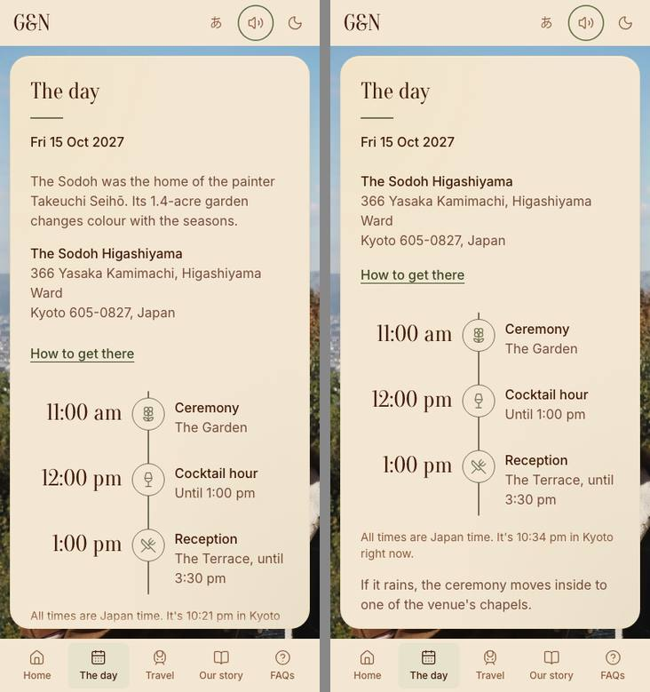
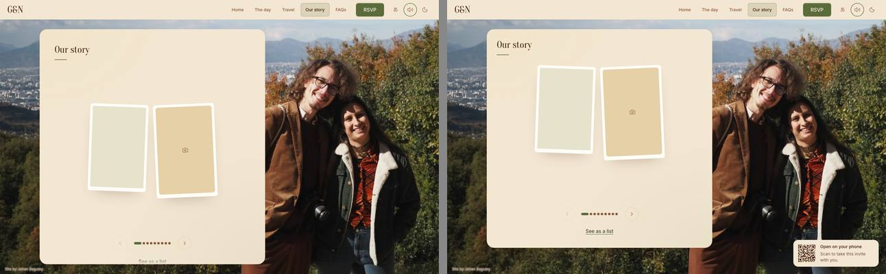

## Section 2: Travel, taps land in the right place

PR #179, branch `feat/r19-travel-scroll`, built on section 1 (#175, merged first): section 1 changes the card's
padding, which moves where Travel's tab row sticks, and both touch `travel.tsx`.

### What changed
- **Sub-tabs.** A tapped tab now scrolls the card to one exact target worked out from the stuck tab row's own CSS
  (`stuckBottom` in `src/lib/frame.ts`), so the section lands 8px under the row whether or not the row has stuck yet.
  Before, it used `scrollIntoView` with a 64px scroll margin: 16px of air, and on the last section (On the day) it
  ran out of room and landed 14px down. `--travel-head` is now 56px (the 48px row and the 8px of air), so the last
  section's spare room matches. Links from elsewhere (`/travel#before`, `#flights`) use the same target.
- **The tab strip** already kept the active tab in view; checked at 390 and 1440, kept.
- **Opening a row.** The site's one accordion (`Disclosure`, used by Travel, FAQs and the sheets) now checks the
  opened row: if its header or the top of its answer (up to 120px, or all of a shorter answer) would be off the
  card or under the stuck tab row, the card glides just far enough to show them, over 300ms with an ease-out.
  Rows already in view don't move. The existing hold (the tapped row stays under your finger while a row above it
  closes) is the same loop, so the two never fight.
- **Reduced motion:** both land at once (tabs `behavior: "instant"`, rows with no glide).

### Decisions
- 8px of air under the tab row ("just under"), not the old 16px.
- 120px of an answer is enough to read its first lines without pushing the header off the top.
- **The day's "How to get there"** is a link that opens Google Maps directions (since c465318), not an accordion,
  so there is nothing on the page to scroll. Left as a link: making it an accordion would repeat Travel's On the day.
  If Jehan wants it as an accordion, it now gets this behaviour for free (it would use `Disclosure`).

### Measurements (gap from the stuck tab row to the section's top, px)
| Tab | 390 before | after | 1440 before | after |
|---|---|---|---|---|
| Getting to Kyoto | 16 | 8 | 16 | 8 |
| Where to stay | 16 | 8 | 16 | 8 |
| Before you fly | 16 | 8 | 16 | 8 |
| On the day | 16 (14 from the bottom) | 8 | 16 | 8 |

No overshoot in any (the scroll never went past its target). Active tab fully in the strip's view every time.

Opening a row whose header sits at the card's bottom edge (Medicines, Walking in): before 4px of the answer showed
and nothing moved; after, the card glides 132px and the header plus 128 to 136px of the answer show (the whole
answer at 1440). FAQs: the last question at 390 moves 11px to show its whole answer; rows already in view move 0.

### Tests
- New in `e2e/travel.spec.ts`: one test taps all four tabs (gap 8, tab current and in view) and opens a row at the
  card's bottom on Travel and on FAQs (header below the tab row, the top of the answer showing). It fails on
  section 1's build.
- travel, faqs, day, rsvp, ask-us, no-jump specs pass locally on 4312. lint 0 errors, unit tests pass.

## Section 3: Arrival, the hand-lettered "Open your invite" is back

PR #178, branch `feat/r19-arrival`.

### What changed
- **The note** (`src/components/arrival-note.tsx`, recovered from before 18e and simplified): "Open your invite" in hand lettering plus the drawn arrow from 6 Oct, which loops once and lands its head last. It's decorative (aria-hidden) and draws on once: the words write in, then the line, then the head. Under reduced motion it's still.
  - Laptops: beside the envelope (left first, since the photo is on the right), the arrow curving in to its side.
  - Phones (standing or lying down) and tablets: above the envelope, the arrow coming down onto the flap.
  - It's placed by rule from the envelope's resting box. It never covers the envelope, Open, the top bar or their faces (`src/lib/face.ts`, restored), and it stays on screen. If nowhere is clear, there's no note.
  - White with a soft shadow over the photo, ink on the paper panel (1024 to 1279).
- **The words** are art, not a font: `public/art/note/note-en.svg` (La Belle Aurore) and `note-ja.svg` (Klee One SemiBold, 「招待状をひらいてね」), both SIL OFL, turned into outlines and used as masks.
  - Why: Nadia's art folder and git history have no scan of these words. The old note was always a font (Klee One, then the display serif).
- **The button under the envelope says "Open"** (ja 「ひらく」). The real button stays for screen readers and keyboards, but with the note saying "Open your invite" it read twice. To revert, change `letter.open` in `en.ts` and `ja.ts`.
- **Seal it again and opening: one clear sequence each** (`src/components/envelope.tsx`). Every step is a Web Animation made at once on one clock, so a test can hold it at any point.
  - Seal: the words fade out (150 ms), the card shrinks into the letter (450 ms), the letter slides into the pocket between back and front (400 ms), the flap closes (250 ms), then the seal presses on (250 ms: her wax seal comes down onto the painted one, with a 3px dip), then it floats again.
  - Open: the same backwards, from the flap opening.
  - The card is never half see-through, and words are never visible while the envelope is on screen over them.
  - The card no longer remounts on seal or open. When open, its wrapper is `display: contents`, so the open pages lay out exactly as before: card rects and pixels matched the before build on all 5 pages at 390 and 1440.
  - Before, "Seal it again" just jumped to sealed.
- **The mini letter:** the gold/green strip along its top is gone (it was `border-top: 4px var(--letter-edge-color)`). It's now a plain sheet with 8px corners and a hairline from the ink, between the back and the pocket. It slides fully clear of the pocket before it grows, so it reads as a rectangle, not the flap's point. Same paper as the card (the existing #165 checks still pass).
- **The open envelope's flat white:** the exports are fine.
  - Both are sRGB, with alpha intact in Chrome's and Apple's decoders.
  - The pocket paper is the same tone as the closed envelope: median 246/230/214 in both.
  - On screen in Chromium it measured 245/228/212.
  - The pale look came from CSS: the closed and open layers cross-faded (both half transparent over the photo), and the envelope faded under a half see-through card.
  - Now the layers swap by folding (clip, full opacity) and nothing fades over them. The test checks the open envelope's strength is 1, with no filter and no blend.
- **The bar while sealed:** no paper colour or texture. The texture (`.site-bar::after`) used to show over the photo. `data-sealed` is now set in index.html too, so it's right from the first paint, and the paper fades back in once open.
- **The phone photo while sealed:**
  - Standing up, the photo fills the screen's height exactly, so object-position had nothing to move. It now sits in its own box (the top 60%, fading into its own blur where the envelope floats), with object-position 50% 70%.
  - Lying down, the photo sits on the right 62% (object-position 50% 55%), with the envelope, note and Open on the left.
  - It glides back to full screen behind the card once open.
  - Laptops keep their framing.
- **1024 to 1279:** the envelope covered Griffin's face in the night photo (the face-box test caught it). In that band the envelope is now 340 wide and a little further left, with the note still beside it.
- **Day photo face box** in `scenes.json` corrected to [0.42, 0.43, 0.75, 0.70]. The old one cut off Nadia's chin.

### Measurements
- Face bottom as a share of screen height, standing up, before → after: 390×844 day 67% → 42%, 320×568 day mostly covered → 42%. All four standing sizes in both themes are now ≤ 45%.
- Opening: 900 ms (with a cross-fade) → 1250 ms in four steps. Seal: instant → 1500 ms in five steps.

### Tests
- `e2e/arrival.spec.ts`:
  - New journey test (motion on in its own context): open, seal, each held at 0/25/50/75/100% (plus 95% for the seal press), checking each step; then open and seal straight through. Seal frames are attached as screenshots on phones.
  - New face-box overlay test: boxes drawn over the faces, note, envelope and Open; nothing may overlap; the note must be on screen; faces in the top 45% standing up. Covers 8 phone sizes (4 standing, 4 lying down) and 4 laptop sizes, in both themes. Linux screenshots at 390 and 1440.
- `e2e/envelope-paper.spec.ts`: button name updated; its frames are now soft and the countdown is masked only once the card shows (the 0% frames were a magenta block over the envelope).
- Lint, unit tests, build and check:pending pass. Local darwin screenshot misses are ignored.

### Skipped / for later
- Tablets standing up (768 to 1023) use the phone framing; I didn't check them closely (not in the brief's list).
- Real Safari wasn't available, so the "flat white" fix is checked in Chromium and reasoned from the CSS.

### For Jehan / Griffin and Nadia
- Nadia: if she'd like to letter "Open your invite" (and 招待状をひらいてね) herself, it drops straight in (`docs/art.md`).
- Jehan: the button now says "Open". Say if you'd rather it said "Open your invite" again.

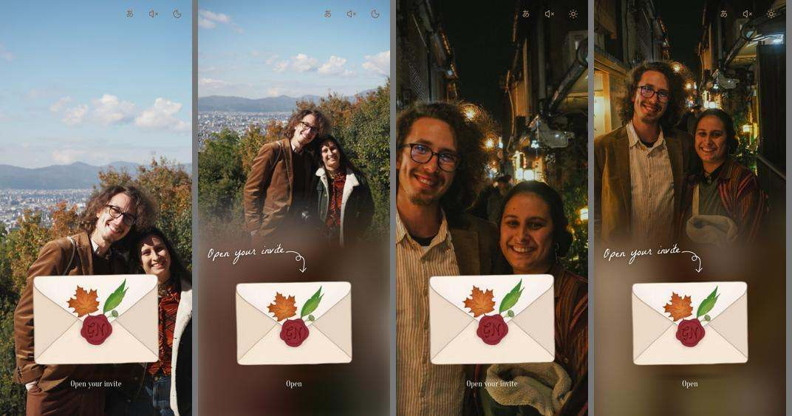
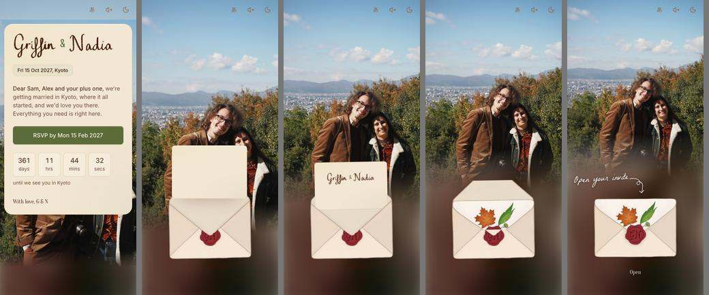

## Section 4: the globe, smooth, see-through, full of lines (PR #176, feat/r19-globe)

### What changed
- **Turning** (`src/components/journey-globe.tsx`): pointer capture on the canvas, and Our story's swipe now ignores
  pointers that start on the globe (that was the "glitchy left and right": a sideways drag turned the globe and moved
  the carousel at once). The view is a latitude and longitude with no wrapping, so no jump at the date line. The
  globe follows its target with damping, glides on with inertia when let go (held still before letting go: no
  glide), and the tilt is clamped to 55°. After the intro (the turn to Kyoto over 3 s) it holds on Kyoto, then turns
  slowly on its own (5° a second). Touching stops the slow turn; it waits 3 s after the last touch and eases back in
  over 1.5 s, so the two never fight. pointercancel and lost capture end a drag too. Reduced motion: held facing
  Kyoto, every line drawn, nothing moving (as before).
- **Look** (`src/lib/paint-globe.ts`): world-atlas countries (110m) instead of one land shape. Every country is its
  own soft wash with a faint border; countries with guests a touch stronger; Australia, Canada, Japan, NZ and every
  guest's country get the painted pooled edges (two blurred strokes plus one a hair offset, so the line wanders). The
  sea is a half-strength wash. The globe is drawn twice: its far side first (faint) and its near side last, so you
  see the far side's countries through it as it turns. Lines sit between the two passes: a line on the far side is
  softened by the near wash, one on the near side is in front. One painting per look, cached, shared with the flat
  map. Guest country codes map to world-atlas ids through `src/data/country-numeric.json` (made by cities-build).
- **Kyoto pin**: "京 Kyoto, 15 Oct 2027" (ja: 京都、2027年10月15日) as an upright HTML label moved to Kyoto's
  screen spot each frame, on whichever side keeps it in the square, dimmed to half while Kyoto is round the back.
  Never mirrored.
- **Lines**: the guest's own line in gold, 3.4 px, with a soft dark edge under it so it holds on pale land and in
  Lantern, drawn last, with a dot at their city. Everyone else's city faint and dotted. The sample household (and no
  back end: the lab, previews, the plain build) always gets the sample lines (`getJourneys(token)`).
- **Globe / Flat**: a small segmented control (28 px items, so above the 24 px target minimum) inside the map's own
  bottom right corner, not above it. Still remembered on the device (`ng-map`).
- **Flat map** (`src/components/journey-flat.tsx`): the globe's painting, cut to the Pacific (90°E to 100°W, 72°N to
  64°S, true scale), so AU, NZ, JP, Canada, Fiji and Hawaii are all on it. A city outside the frame comes in from the
  nearer edge. Same lines, Kyoto seal and label, legend under it, the lines-drawn count when there is one. The small
  hand-drawn map stays on the reply's "Where are you flying from?" card and Options (out of scope).
- **City search** (`scripts/cities-build.mjs`): every country. Kept: 5,000+ people in AU, NZ, CA, JP (as before),
  30,000+ elsewhere (was 100,000), and in every country its capital and its three biggest places whatever their size.
  Suva, Nadi, Auckland and Honolulu resolve (unit test). A side effect: lots of small towns share famous names
  (Victoria, Texas), so an exact-name match outside the four home countries under 100,000 people now ranks after a
  state's own suggestions (keeps "Victoria" giving Victoria BC and Melbourne first, as before).
- **Quick chips**: only the nine from the brief, in three groups, in one config file `src/data/flying-chips.json`
  (edited by hand; `src/content/flying-chips.ts` is gone). cities-build checks each chip is the same GeoNames city.
  Brisbane, Melbourne, Sydney / Edmonton, Victoria (BC), Vancouver / Tokyo, Osaka, Kyoto under "Already in Japan"
  (日本国内から). A Japanese city counts as Already in Japan in the map's label and in the sheet (the back end
  already buckets country JP that way); Tokyo and Osaka get a short line, Kyoto none.

### Decisions
- Cut-off 30,000 elsewhere: 15,000 (GeoNames' own tier) made the index 964 kB gzipped; 30,000 is 600 kB and still
  covers Nadi (42,000) with room. Plus capitals and each country's top three, so no country is missing (245 countries).
- Kept the index lazy (fetched on first focus of the field, never on page load), so page weight is unchanged.
- Flat map as a fixed Pacific frame rather than fitted to every guest: a fitted frame with a London guest is most of
  the world and mostly empty sea; the edge entry is what the old map did.
- Japan chips as real cities rather than the old "Already in Japan" special: the brief lists Tokyo, Osaka, Kyoto.
  Old saved "jp" answers still work.

### Measurements
- City index: before 8,182 cities, 644 kB, 259 kB gzipped. After 20,016 cities, 1,415 kB, 600 kB gzipped. Search
  stays well under the existing "fast enough" test.
  - load (paint + first frame, before the globe shows): 6 frames, one 167 ms (the painting)
  - intro (lines drawing, turn to Kyoto): 242 frames, 60.0 fps, p95 16.7 ms, none over 20 ms
  - drag: 81 frames, 60.0 fps, none over 20 ms
  - glide: 180 frames, 60.0 fps, none over 20 ms
  - slow turn back: 180 frames, 60.0 fps, none over 20 ms
  - On SwiftShader (software GL, as in CI) it's about 30 fps: that's the CPU drawing the GL, not a phone.
- Live journeys: `?action=journeys` answers `{ ok, cities }`, cities is a list, **0 cities** today (no coming
  household has picked a city yet). That's why the sample household now always shows sample lines.

### Tests
- `e2e/globe.spec.ts`: Kyoto pin shows its date and has a side; the control sits inside the map's bottom corner; a
  sideways drag on the globe leaves the story on its last stop; the flat map shows the 8 sample lines; no WebGL
  starts flat.
- `tests/city-search.test.ts`: Suva, Nadi, Auckland, Honolulu, 240+ countries.
- lint, unit tests, build, check:pending pass. rsvp flying test passes with the new chips.

### Lab
- Section 9's globe looks belong to the lab session; nothing in `src/lab` touched.

### For Jehan / Griffin and Nadia
- The chip list is now exactly the brief's nine; Adelaide, Perth, Calgary and Toronto are gone from chips (still
  searchable).

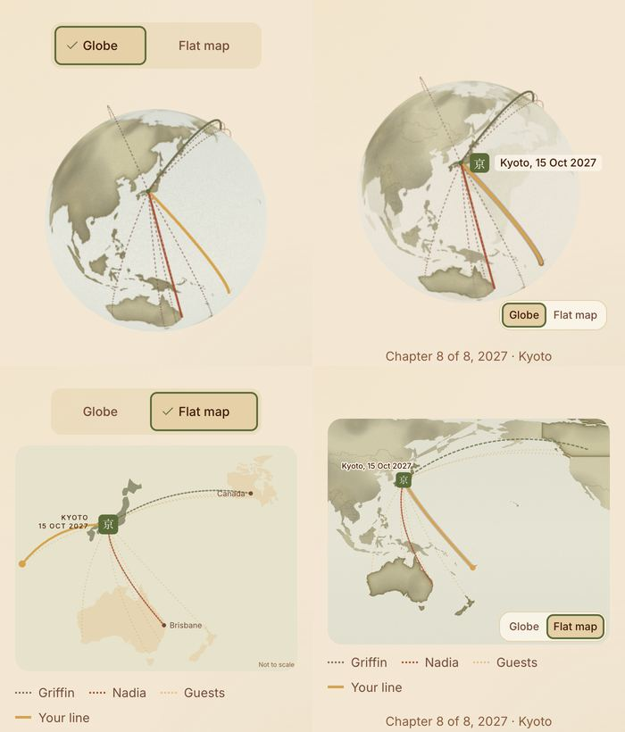

## Section 5: confirmation, the fortune folds open; songs stay at two (PR #177, feat/r19-fortune)

### What changed
- **Centred**: from 768 up the slip sat to the left. `.done-column > .sent-next > * { margin: 0 }` beat the slip's
  `margin-inline: auto`. The fortune now sits in its own stage, and the slip is centred inside it at every width.
- **Folds open like an omikuji** (`src/components/fortune-card.tsx`, `src/index.css`): after the tin's shake (900 ms,
  unchanged) the slip comes out folded in three, 大吉 on top. The middle third swings open from the first crease, then
  the last from the second (nested, so it rides with the middle until its turn). The back of each third is plain
  paper. Each third's shade lifts as it flattens, and each lands with a little give (3° and 4° past flat, then
  back). Then the creases, sharp while it opens, ease out over 900 ms to the two faint lines the slip always had.
  About 1.1 s for the fold. Three inert, aria-hidden copies of the slip do the folding over the real slip, which holds
  its place from the start (nothing below moves) and takes focus, so screen readers and keyboard users get one slip.
- Reduced motion: no shake, no fold, the slip fades in (as before). A slip opened on an earlier visit just fades in.
- Removed the old `slip-unfold` scale and the unused `.is-spring` rules.

### Songs: already two in the form, three in the back end
- Evidence it was 2 on the site: `SONGS = 2` in `src/components/rsvp-sheet.tsx` is passed as `max` to the song
  picker, and the e2e "the song search ... up to two" checks "2 songs added. Remove one to change it."
- But `apps-script/Code.gs` had `MAX.songs: 3`, and `src/lib/config.ts` had an unused `maxSongs: 3`. Back end now 2
  (keeps the first two it's sent), with a unit test; the dead setting is gone.
- **Needs a clasp push** after merge: done, version 48.

### Tests
- New e2e (`e2e/rsvp.spec.ts`, motion on): the fold's two leaves appear, the real slip is focused while folding,
  the fold is gone within 4 s, the slip is centred in the column, one "Great blessing" group for screen readers.
- `tests/apps-script.test.ts`: MAX.songs is 2.
- lint, unit tests, build, check:pending pass; rsvp fortune and song tests pass locally.

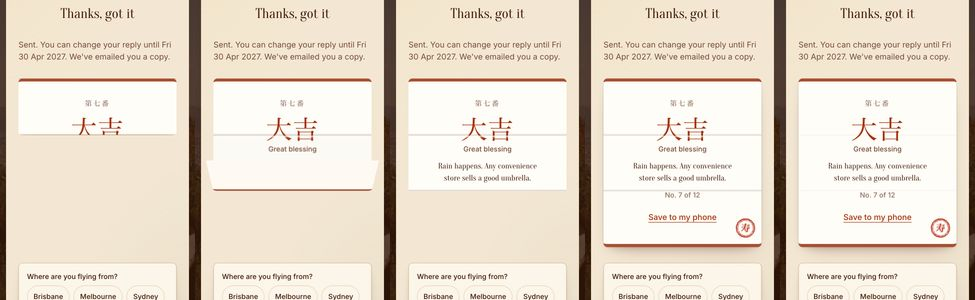
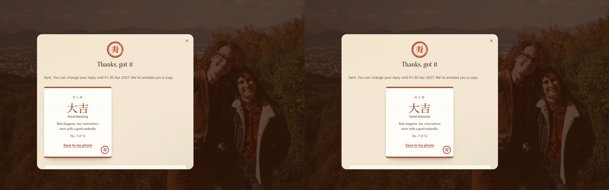

## Section 6: FAQs and copy in Griffin and Nadia's voice (#171)

- Every answer shorter and warmer, with nothing said twice (the plus-one answer points to Ask us instead of repeating
  the email address).
- Regrouped the way a guest wonders reading the invite: can I bring someone, what kind of day, what to wear, food,
  gifts, then visas, what happens to my details, and Who made this site? last. `e2e/faqs.spec.ts` follows the new
  order in English and Japanese.
- Who made this site?: "Nadia's brother Jehan designed and built it, and Nadia drew everything you see. The song is A
  Town With an Ocean View (Joe Hisaishi), played on piano." The music credit is still said only here. **Jehan to
  confirm the wording.**
- Ask us at the end of FAQs: "Can't see your question here? Ask us and we'll get back to you.", then "Ask us".
- All new copy is in `src/content/pending.ts` with ja versions; the new Japanese is on the native-read list and the
  read pack is regenerated.
- The phone FAQs page is 52px longer than before (781 against 729 at 390): the new Ask us intro is two lines.

## Section 6b: names lettering check (#180)

- "N adia": overlay-diffed against Nadia's 18 Oct source at 1040. The render matches her drawing; the gap after the N
  is in the art itself (26px on her 2500px file), not the mask cut or #165's spacing. No change to the art. A new gate
  in `e2e/names-gap.spec.ts` checks each word's spacing at 1040 in both themes so it can't drift. If the gap still
  reads wide, it's one for Nadia to redraw.
- Home's four tags: on a phone (under 560px) a calm 2x2 grid instead of wrapping with Travel dates alone on a row.
  All four on one row didn't fit at 390 at a readable size, so the grid won. At 320 they stack.

## Section 7: credit and logo (#181)

- Laptops (1024 up): Nadia's wax seal, 24px at 40% opacity, bottom left on every page. Hover or keyboard focus brings
  it to full and reveals "Site by Jehan Baguley" on a small chip of the letter's paper (AA over any photo). Visible
  focus ring, 24px target; screen readers hear the words at rest. Instant under reduced motion.
- Phones: no credit line on Home any more; the FAQ answer covers it.
- The G&N in Nadia's own lettering for the top bar is lab work, so it's left to the lab session (not built here, and
  nothing marked ready to ship). The current G&N stays.

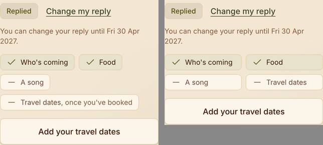
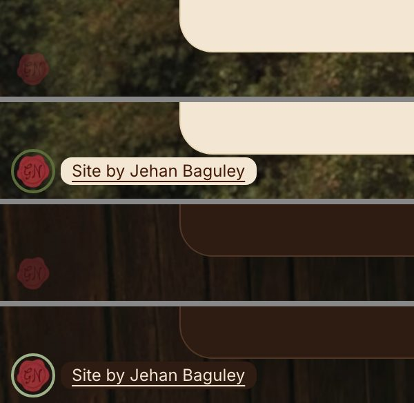

## Section 8: motion and performance pass

PR #182 (`perf/r19-motion`). Merged with main after #171 and #179 landed; re-tested after the merge.

### What changed
- **Tokens** (`src/styles/tokens.css`): fast 150 ms, base 250 ms (was 300), slow 450 ms (was 600). One easing
  family, the paper curve: `--ease-paper` (out: arrive or settle), `--ease-out` (now its mirror, in: things
  leaving), `--ease-paper-in-out` (new: a part moving from one place to another, same curve the arrival's flap already
  used). `--ease-spring` (overshoot) removed; its six CSS uses and the page-turn snap-back use the paper curve.
- **Theme circle** (`lantern-toggle.tsx`): in Chromium it already started at the button at 1440 and 390 (frame grab
  below). It now also animates the circle on the snapshot itself after `vt.ready` (WAAPI with
  `pseudoElement: "::view-transition-new(root)"`), alongside the existing stylesheet one. That's the usual way this
  reveal is built, and it covers a browser that skips the stylesheet animation, which is the likeliest cause of the
  "grows from the middle on desktop" report. Identical keyframes, so Chromium looks the same. Duration is the slow
  token (450, fallback was 760).
- **e2e gate** (`e2e/page-change.spec.ts`, phone 390 and laptop 1440): the "starts at the toggle's centre" test now
  also reads the circle the browser is really drawing mid-reveal (the snapshot's computed `clip-path`, radius above
  0), does the second switch after a page change (laptops change pages with their own view transition), and checks the
  reveal runs 450 ms. The existing first-visit screencast test stays.
- **Accordions**: no height animation. The answer opens at once and fades and rises 6px in (base); closing is a
  plain close. #179's "glide into view" timing moved from 300 to 250 ms to match base.
- **Story prints** (`story-journey.tsx`): the drag and spring loop read each print's width after writing the
  previous print's styles, which forced a fresh layout per stop every frame. All reads now happen before any write.
- Story dots: width steps instead of animating (only the colour fades). Hard-coded 700, 400, 400, 400, 200 ms moved
  to tokens. Dead `data-vt="fade"` CSS removed.
- `scripts/perf-trace.mjs`: the lag check, kept so it can be re-run (`node scripts/perf-trace.mjs <port> [runs] [trace.json]`).

### Decisions
- Kept the arrival exactly as #178 left it (sequence, durations, its 400 ms slide, its float loops): changing the
  slide to 450 moves every frame `envelope-paper.spec` holds, and #178 just settled those. Logged below as exceptions.
- Kept colour, border and shadow transitions on hovers and presses (150 ms): they repaint but never re-lay out, and
  swapping them for opacity layers would add elements for no measurable gain.
- Kept the width on the dock pill and the segmented control's marker: they're absolutely placed, empty boxes, so a
  width change re-lays out only that box; scaling instead would squash their rounded corners and inset line.
- Accordion close is instant rather than a fade: a fade followed by the height snapping shut looked worse than either.
- Didn't touch the globe or credit files (#176, #181 open).

### Animation audit (before, after)
| Animation | Before | After |
|---|---|---|
| Envelope (arrival) open and seal | WAAPI: transform, opacity, clip-path, plus left/top/width/height for "grows into the card"; 150/250/400/450 | Unchanged (arrival, #178). Exception: the grow step animates layout; flagged for a later FLIP pass |
| Envelope float, Open breathe | translate/rotate/scale, opacity, 4 s loop | Unchanged (arrival) |
| Arrival note handwriting | clip-path, stroke-dashoffset, 900/950/240 ms | Unchanged (arrival) |
| Phone arrival photo box | bottom/left/object-position/mask, slow | Unchanged (arrival); now 450 via the token. Exception: layout |
| Names lettering, first visit | clip-path 1400 ms | Unchanged (part of the first arrival, never again) |
| Page change (laptop) | view transition, opacity + translate, fast/base | Same, now 150/250 |
| Page turn (phone swipe) | transform, will-change set and cleared in JS; spring snap-back | transform; paper curve snap-back; fallback 250 |
| Dock pill | translate/transform + width/height, fast | Unchanged (exception, see Decisions) |
| Travel tabs and jump links | colour/background, fast | Unchanged (paint only) |
| Segmented marker | transform + width, fast | Unchanged (exception) |
| Sheets | transform + opacity, slow 600 | Same, 450 |
| Sheet steps | transform + opacity, base 300 | Same, 250 |
| Accordions | height (Radix accordion-down/up), base 300; chevron 200 | opacity + translate on open, base 250; chevron base |
| Fortune (omikuji) | rotate, translate, rotateX, opacity; 1100 ms fold on its own curve | Same properties; fold on the in-out token, shade on paper; shake now 675 (1.5 x slow) |
| Story prints | transform + opacity in JS, but a forced layout per stop per frame | transform + opacity, reads batched |
| Story dots | width, fast | width steps, colour fades |
| Journey map (Our story) | stroke-dashoffset 900 ms, opacity slow | Same, 2 x slow (900) |
| Globe | canvas, own frame loop (`frame.ts`) | Not touched (#176) |
| Theme circle | clip-path on the snapshot from the stylesheet, slow 600 | Same plus WAAPI on the snapshot, 450 |
| Countdown digit | transform + opacity, base | Same, 250 (a live clock, not a load animation) |
| Photo fade on load | opacity 400 ms | opacity, slow token (a loading state, so it never pops) |
| Paper texture fade | opacity 400 ms | opacity, slow token |
| Laptop photo drift | transform 700 ms | transform, slow |
| Music waiting pulse | box-shadow loop 2.4 s | Same loop, in-out curve (only while the music is waiting) |

On page load (repeat visit, every page, 390 and 1440): nothing animates except the live countdown and the loading
skeleton's breathe; the names write in only on the first visit. `will-change` is only set while moving (page turn sets
and clears it; the `.letter-ghost` that carries it exists only during a turn). Reduced motion: the global rule zeroes
every CSS duration, the tokens are 0, and every JS motion (arrival, page turn, story, theme, fortune) checks it.

### Lag measured (Pixel 7 size, 4x slower CPU, motion on, 5 runs; medians, longest is the max)
| Interaction | Long tasks > 50 ms | Dropped frames (median / max) | Main thread ms | Layouts | Style recalcs |
|---|---|---|---|---|---|
| Envelope open | 0 to 0 | 0/0 to 0/0 | 120 to 120 | 71 to 61 | 194 to 190 |
| Page change | 0 to 0 | 0/1 to 0/1 | 112 to 106 | 7 to 7 | 47 to 44 |
| Theme switch | 0 to 0 | 1/1 to 1/1 | 67 to 67 | 11 to 11 | 71 to 58 |
| Open a sheet | 0 to 0 | 0/0 to 0/0 | 85 to 85 | 5 to 5 | 68 to 53 |
| Accordion | 0 to 0 | 0/0 to 0/0 | 50 to 36 | 24 to 3 | 31 to 27 |
| Story swipe | 0 to 0 | 0/0 to 0/0 | 47 to 39 | 11 to 3 | 446 to 61 |

Headless Chromium on this Mac never hit a long task, so the wins are in work per frame (layouts and style recalcs),
which is what costs on a real phone. The theme switch's one dropped frame is the browser taking the snapshot, which
every view transition needs. Chrome traces of the envelope run: scratchpad only, not committed.

### Tests
- `npm run lint` (0 errors), `npm test` (63 pass), `npm run build`, `npm run check:pending` (0).
- Locally on port 4308 after the merge: arrival, page-change, story, travel, faqs, rsvp, perf: 88 passed, 4 skipped;
  the only failures are the 4 arrival "faces" screenshots with no darwin baseline (expected locally).
- `envelope-paper.spec` fails locally on main too (stale darwin baselines), so I left the arrival's frames alone.

### For Jehan
- I couldn't test Safari or Firefox here (the work Mac blocks the WebKit download). If the circle still grows from
  the middle on your desktop, tell me which browser: the next step would be dropping the stylesheet circle for the
  WAAPI one alone.
  growing from the moon button).

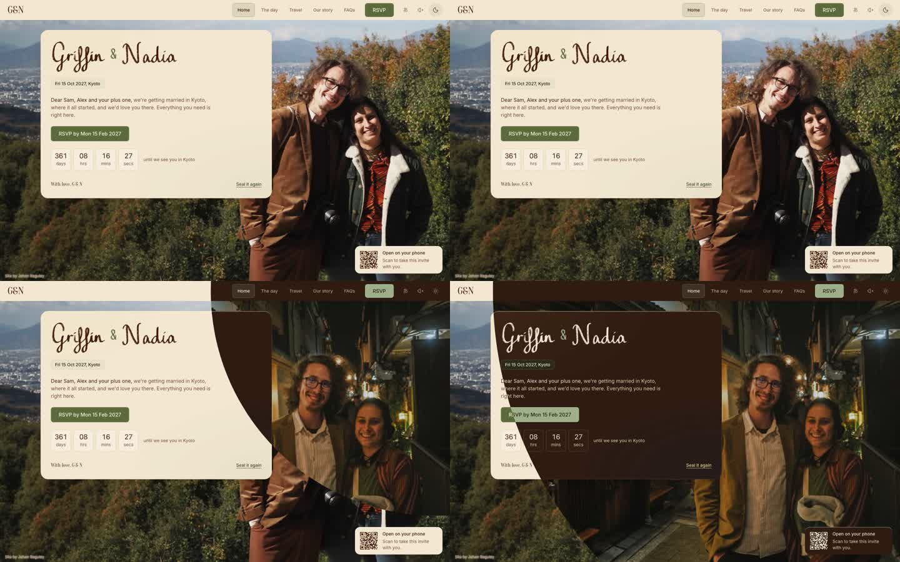

## Section 9: the lab

Run by the lab session in parallel, in its own worktree and PRs (#170, #173 and after), touching only the lab's
files. This session didn't edit them. docs/lab.md on main lists nothing under "Ready to ship", so nothing from the lab
went to the site in this run. The three story takes and the three globe looks, each with its "Deciding:" line, are in
the lab for Jehan, then Griffin and Nadia.

## Section 10: back end and sheets, ready and easy to work through

PR #174, branch `feat/r19-sheets`. Back end and docs only; no site changes, so no screenshots.

### What changed

- **Two menu items** (Wedding site): "Tidy the sheets (report)" changes nothing and lists every change, tab by tab,
  and every row and column that would move, by row number. "Tidy the sheets: do it" asks, then works the plan out
  again under the save lock and runs exactly that. Plus "Refresh the To look at box".
- **Tab order:** Summary, Guests, RSVPs, Questions, Songs, Content, How to update, then any others (Emails), then
  Crew, Log, Archive.
- **Every data tab** (Guests, RSVPs, Questions, Songs, Content, Emails, Crew, Log): frozen bold header, filter on,
  light grey banding, column widths by heading, timestamps as `3 Oct 2026, 9:41 am`.
- **Seen tickboxes** at the end of RSVPs and Questions. Ticking Seen on RSVPs stamps "Seen at" (onEdit).
- **Questions:** Status dropdown (new, answered, published), honey colour on rows still new.
- **RSVPs:** honey "Changed" highlight when Responded at is later than Seen at.
- **Summary:** a 13-row To look at box at the top (new questions, new or changed replies, not replied yet, dietary
  needs), each line a HYPERLINK to its row, refreshed every time the sheet opens once it's there.
- **How to update:** "Your weekly 5 minutes" inserted at the top.
- **Archive:** Log rows from before the first real invite, and stale helper columns, copied with copyTo (keeps the
  leading `'` and formats), checked cell for cell, then taken out of their tab. Nothing deleted.
- **docs/sheets.md:** every tab and column, the tidy, the routine. README menu table and data-model link updated.
- **Tests:** `tests/sheet-tidy.test.ts` (tab order, the test-era rows, helper columns, the gap plan, Changed, the
  To look at list and its cells, including a quote in a name and "and N more"), plus one in `apps-script.test.ts`
  for the outbox token. 56 of 56 unit tests pass; lint (0 errors), build and check:pending pass.

### Found on the way (fixed in the same PR)

- **Questions landed at row 1001.** `questionsSheet_` made the Publish tickboxes with `insertCheckboxes()`, which
  writes FALSE into all 999 rows, so `appendRow` put every new question below row 1000. Now a tickbox rule
  (`requireCheckbox`), and the tidy clears the unticked boxes on empty rows and moves rows below the gap up, in order.
- **"Check the email queue…" threw** whenever an Ask us or "Send my link" email was waiting: it pushed `q:out` items
  into a list that didn't exist. Now listed as "Other emails waiting".
- **Test households' outbox emails couldn't be cleared**: Ask us notes, links and answers had no household on them.
  They now carry the token inside (stripped before sending), and "Clear queued items for test households" clears them.
- `?action=check` now includes the household's saved city (`flying`), so the live check can see "flying from" stored.

### Decisions

- Test era = before the first Log row of Kind "Invite sent" (or the older wording). Data, not a hard-coded date.
  Before any invite, nothing counts as test era.
- Helper columns: only to the right of every known column, and only when empty under an unknown heading or holding
  something under no heading. An unknown heading with data stays and is listed ("say if it should go"): it could be
  Nadia's notes. Never moving a column between known ones keeps Questions' positional `appendRow` safe.
- "Never deleted" read as "no data lost": rows move by copy, check, then remove. A failed check stops before removing.
- The box sits in rows 1 to 13 of Summary (rows inserted, so existing formulas shift and keep working); side by side
  columns keep it short. Up to 10 lines per list.
- Seen at stamped by onEdit rather than changing the save path, so the web app's behaviour doesn't change.
- Arriving and Leaving stay as the text the site saved (changing them to dates would rewrite guests' answers).
- Test households are listed like everyone else in To look at (their names say "test").

### Live checks (test households only, shapes and pass/fail only)

**Before** (live back end before this PR, 19 Oct): 18 pass, 0 fail, 3 skip.

- pass: health, ping, songs (6 results), journeys (cities list), flying counts, questions, content, fortunes, stay,
  both test households found, check, RSVP edit (one RSVPs row, songs replaced, Changed reply logged), RSVP can't come
  (all no, dietary cleared, flagged), reply put back, flying from (answer ok; storage not visible on this back end),
  can't find your invite (neutral answer for an unknown address), email queue held (queue account "other", pending
  2 to 3, all confirmation mail for the test household), health afterwards.
- skip: RSVP new (both test households have replied; needs "Reset test households"), Ask us and the queued link
  (the old back end's outbox items can't be cleared for test households, so not sent until after the push).

**After** (version 47, main at 30f7970, 19 Oct): 19 pass, 0 fail, 2 skip.

- New since before: check shows the stored city (flying from: name, country, lat, lon stored), Ask us saved with
  its email to you queued and held (outbox 0 to 1, tagged to the test household so it can be cleared).
- Everything else passed as before: health, ping, songs, journeys, flying counts, questions, content, fortunes, stay,
  RSVP edit, can't come, reply put back, neutral "can't find your invite", queue held (account "other", pending 3 to
  4: three confirmation emails and one outbox email, all for test households), health afterwards.
- skip: RSVP new (needs "Reset test households"), the queued "Send my link" email (needs a test household's address
  in RESEND_EMAIL).

### For Jehan

- After the push: run "Tidy the sheets (report)", read it, then "Tidy the sheets: do it".
- "Reset test households" before the after-check if you want a first reply checked too.
- Clear the test households' queued items ("Clear queued items for test households…") before turning the queue on.

## Section 11: stress test, a user-testing pass

PR #183, branch `test/r19-ux` (brought up to date with main after #182, the motion pass).

### What was done
- Walked eight guest profiles through all nine tasks with Playwright against a local build of the sample household
  (no back end, so the reply, Ask us and "email me my link" are local; said so in the doc). Each profile had its own
  fresh device, time zone and locale: Brisbane aunt on an iPhone 13 with motion on, Edmonton on a Pixel 7 with a plus
  one, a ja-JP phone in Tokyo, can't come (London), coeliac plus nut allergy, keyboard only on a laptop, a screen
  reader pass (roles, names, headings, focus, live regions, 24 px targets) and a lost link.
  debug scripts `s11-explore.mjs`, `s11-dbg*.mjs`. Not in the repo, so CI didn't grow.
- Wrote `docs/ux-test.md`: the profiles, a journey map (task, path, taps, scrolls, automation time, a person's time,
  friction), what each profile found, screenshots, and issues P0 to P3.

### Results
- Every task completed for every profile, no console errors. Per guest, all nine tasks: 10 to 14 s of automation,
  24 to 29 taps (keyboard 112 keys), 2 to 7 screens of scrolling. Reply 6 to 11 taps; RSVP is 12 Tabs from the top.
- No P0.

### P1s, fixed
1. Phone sheets ran 12 px off the right edge (the X crowded, the corner cut). Cause: #175 gave `.letter` `width: 100%`,
   and sheets are letters, so a fixed sheet was the screen's width starting 12 px in. Fix: `.sheet { width: auto }`
   (left and right place it; laptops already set a width). Measured on iPhone 13: 390 wide at x 12 (right edge 402 on
   a 390 screen) before, 366 wide (right edge 378) after.
2. Everyone named coming with no plus one got "Thanks, got it" (the mixed title) instead of "You're all set": the
   unused plus one counted as not coming. Fix in `answerOf`: a plus one nobody is bringing doesn't count. Before:
   aunt, coeliac, keyboard, screen reader and lost-link profiles all saw "Thanks, got it"; after: "You're all set".
3. After replying, "Back to your invite" left keyboard and screen reader focus on the page body: the opener (the RSVP
   button) had been replaced by Change my reply. Fix in `SheetContent`: if the opener is gone, focus the letter, and
   retry one frame later because the letter is `visibility: hidden` while the RSVP sheet's `data-sheet` is still set.
- e2e: the existing done-screen test (rsvp.spec.ts) now checks the exact "You're all set", that the sheet's right
  edge is inside the screen, and that the letter has focus after Back to your invite. No new tests.

### P2 and P3, listed in the doc
- P2: a Japanese phone starts in English (held until the Japanese read); the music button changes its name and is
  also aria-pressed; no Coeliac chip (Other covers it); Ask us only on the FAQs.
- P3: FAQs headings jump h1 to h3; the taxi card is an h2 inside an h2 section; a stray space in "How to get there ,
  opens Google Maps"; "Is this it?" can suggest an unrelated FAQ; RSVP by 15 Feb vs change until 30 Apr; Japan time
  only on The day; Home after replying doesn't say who's coming; without an invite Ask us shows the email error
  when the name is missing.

### Decisions
- Kept the P2s unfixed: the brief asks for P0 and P1 fixes, and each P2 touches copy or a choice that's N&G's or
  Jehan's (Japanese default, a chip, where Ask us lives).
- Focus goes to the letter, not to Change my reply: one generic rule in the shared sheet covers every sheet whose
  opener disappears, and the next Tab lands on Change my reply anyway.

### Tests (local, port 4311)
- `npm run lint` 0 errors (17 warnings, same as before), `npm test` 64 pass, `npm run build` ok, `npm run check:pending` exit 0.
- e2e: rsvp, ask-us, keyboard-overlay, travel, stress and day specs: 71 passed, 5 skipped. pages, safety-net and
  layout: only the expected darwin screenshot diffs fail.
- Expect Linux screenshot changes on any phone shot with a sheet open (its right edge now sits inside the screen).

### For Jehan / for Griffin and Nadia
- Jehan: a real-phone pass of the reply sheet's edges and VoiceOver on an iPhone would confirm the two
  emulated findings.
- N&G: a Coeliac chip or a line in the food FAQ that allergies go to the kitchen; whether two dates (RSVP by
  15 Feb, change until 30 Apr) are meant; whether the site should start in Japanese on Japanese phones once the read
  is done.
