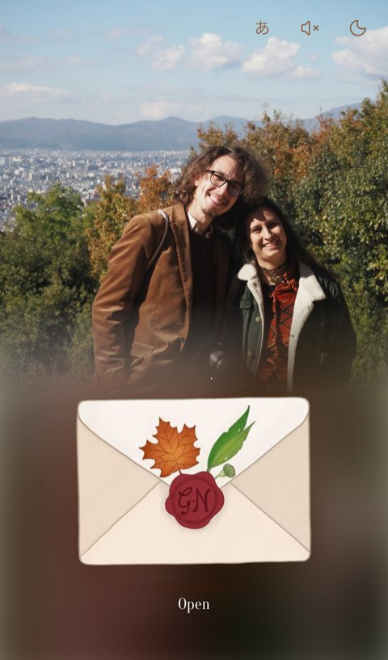
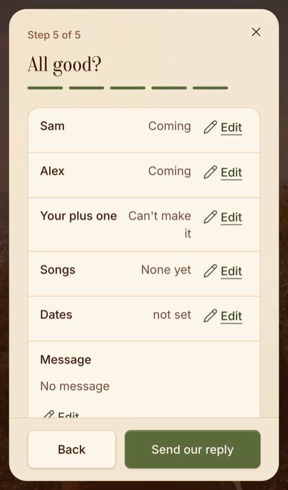
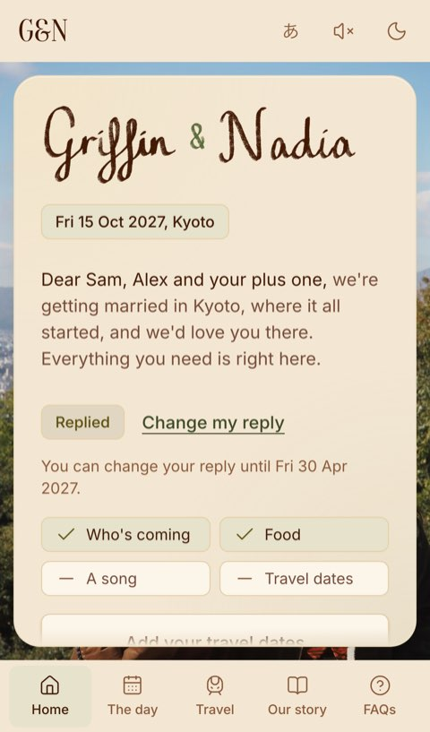
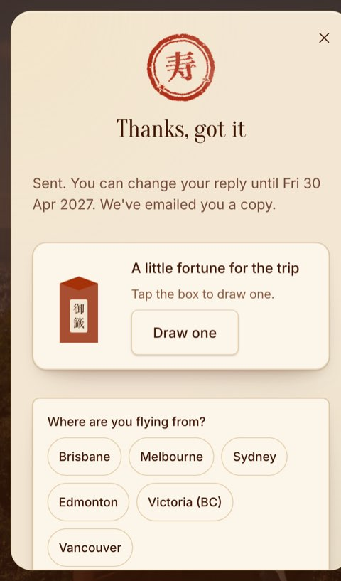
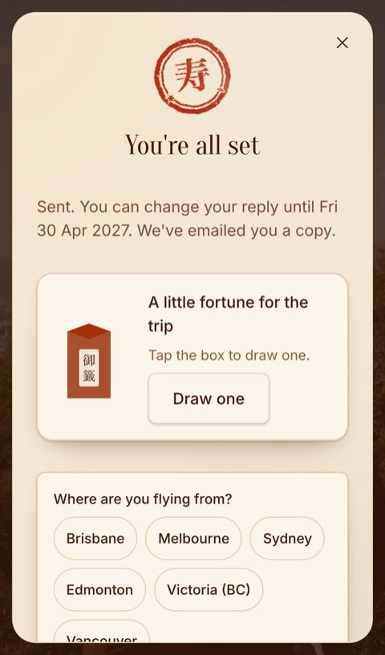

# UX test: eight guests, every task (run 19)

A user-testing pass of the guest site, run with Playwright against a **local build of the sample household** (Sam,
Alex and a possible plus one). There's no back end in that build, so replies, questions and "email me my link" save or
answer locally; nothing was sent anywhere. The walk script lives outside the repo (`.brief/tools/r19/s11-walk.mjs`), so
CI didn't grow.

Each profile ran on its own fresh device (no saved invite), in its own time zone and locale:

| # | Guest | Device | Time zone | Notes |
| --- | --- | --- | --- | --- |
| 1 | An aunt in Brisbane, first time on the site | iPhone 13 | Australia/Brisbane | Motion on, so the envelope opening plays |
| 2 | A friend in Edmonton with a plus one | Pixel 7 | America/Edmonton | Ticks "Bringing someone?" and names them |
| 3 | A Japanese guest reading in ja | iPhone 13, ja-JP | Asia/Tokyo | Switches with the あ button, then every task in Japanese |
| 4 | Someone who can't come | Pixel 7 | Europe/London | Both "Can't make it", then changes their mind |
| 5 | Coeliac plus a nut allergy | iPhone 13 | Australia/Sydney | Gluten free, Nut allergy, Other with words |
| 6 | Keyboard only | Laptop 1440 | Australia/Melbourne | Tab, Enter, Space, arrows, Escape; no mouse |
| 7 | Screen reader (VoiceOver profile) | iPhone 13 | Australia/Perth | Walks roles, names, headings, focus and live regions |
| 8 | Someone who lost their link | iPhone 13 | Australia/Brisbane | Opens the bare address, asks for the link, then opens it |

The tasks, for each: open the invite, reply, change the reply, find the address and how to get there, find hotels,
find the dress code, ask a question, find the date and time in Japan time, add to calendar.

## Journey map

Times are the automation's (how long the site took to respond to each step); the human column is a judgement from the
taps, keys and scrolls it took. "Scrolls" is how many screens down the thing sat.

| Task | Path | Taps | Scrolls | Automation | A person | Friction |
| --- | --- | --- | --- | --- | --- | --- |
| Open the invite | Link, then Open under the envelope | 1 | 0 | 2.0 to 2.9 s (1.3 s envelope to letter) | 5 s | None. With reduced motion there's no envelope: the letter is just there. |
| Reply | RSVP, a radio per person, Next x4, Send | 6 to 11 | 0 | 1.5 to 3.3 s | 45 to 90 s | Was: "Thanks, got it" when everyone named was coming but no plus one (fixed). Was: the sheet ran 12 px off the right of a phone (fixed). |
| Change the reply | Back to your invite, Change my reply, Next x4, Send | 8 | 0 | 1.6 to 3.0 s | 30 s | Was: keyboard and screen reader focus fell to the page after closing (fixed). |
| Address and how to get there | The day: address on the first screen, How to get there opens Maps | 2 | 0 (Show the driver on Travel is 2 to 4 down) | 0.2 s | 5 s | None. |
| Hotels | Travel, Where to stay, Hotels | 2 to 3 | 0 | 0.9 to 1.2 s | 10 s | None. Six hotels, each a link out. |
| Dress code | FAQs, 3. What should I wear? | 2 | 0 | 0.7 to 1.1 s | 10 s | None: "no dress code, bring shoes for cobblestones". |
| Ask a question | FAQs, Ask us (one screen down), type, Send | 2 + typing | 1 | 1.1 to 1.6 s | 30 s | Only offered on the FAQs (and on errors or without an invite). "Is this it?" can suggest an unrelated FAQ. |
| Date and time in Japan time | The day: "All times are Japan time" under the timeline | 1 | 0 to 1 | 0.1 s | 5 s | Your own time isn't shown (a choice made earlier; the calendar converts). |
| Add to calendar | The day, one screen down: Google or .ics | 1 | 1 | instant | 5 s | None. Both say 11:00 am to 3:30 pm Japan time (02:00 to 06:30 UTC). Also on the "all set" screen. |

Per guest, all nine tasks: 10 to 14 s of automation, 24 to 29 taps (keyboard: 112 keys), 2 to 7 screens of scrolling.
Every task completed for every profile. No console errors.

What each profile found on top of that:

- **Aunt (iPhone, first time):** the envelope, Open, the letter. Nothing to learn. The RSVP button says "by Mon 15 Feb
  2027" and the sent line says "change until Fri 30 Apr 2027": two dates close together.
- **Edmonton (plus one):** tick, a name, done in 2 taps and 6 letters. The greeting then says "Sam, Alex and Jordan".
- **Japanese guest:** the site starts in English on a Japanese phone; the あ button is one tap in the top bar, and then
  everything (reply, FAQs, Ask us, calendar) works in Japanese.
- **Can't come:** 3 steps (who, a note, the check), "Thanks for letting us know", no stamp. Changing to coming later
  works and offers the travel dates.
- **Coeliac plus nut allergy:** Gluten free and Nut allergy are chips, and Other takes "Coeliac, so no
  cross-contamination please". No "Coeliac" chip, and the food FAQ doesn't say allergies reach the kitchen.
- **Keyboard only:** RSVP is 12 Tabs from the top; every tab stop on every page shows a focus ring (22 to 53 stops a
  page); chips toggle with Space; Escape closes sheets and focus goes back to the opener.
- **Screen reader:** the reply sheet is a named dialog, focus goes to each step's heading, the check reads as a
  definition list, the "all set" heading takes focus and the sent line is a status. No unnamed controls, no images
  without alt, no targets under 24 px.
- **Lost link:** the bare address says "Can't find your invite?" with one email field ("If that email's on our list,
  your link is on its way. Check junk too.") and Ask Griffin & Nadia.

## Screenshots

Sample household, phone.

| Opening | The check | Replied, on Home |
| --- | --- | --- |
|  |  |  |

The P1s on the done screen, before and after:

| Before | After |
| --- | --- |
|  |  |

## Issues, ranked

P0 stops a guest replying or finding something they need. P1 is a real defect on a common path. P2 is friction worth
fixing. P3 is polish or a note for Griffin and Nadia.

### P0

None.

### P1 (all fixed in this PR)

1. **Every phone sheet ran 12 px off the right edge**, cutting its rounded corner and crowding the X (reply, Ask us,
   hotels, the driver card). The letter got `width: 100%` this run (#175), and a sheet is a letter, so a fixed sheet
   was the full screen width starting 12 px in. Fix: the sheet sets `width: auto` (left and right place it; laptops
   already set a width). `src/index.css`.
2. **"Thanks, got it" instead of "You're all set"** when everyone named is coming but they aren't bringing a plus one:
   the unused plus one counted as someone not coming. That's most households. Fix: a plus one nobody is bringing
   doesn't count. `answerOf` in `src/lib/api.ts`.
3. **Focus fell to the page after a reply** (keyboard and screen reader). "Back to your invite" returns focus to what
   opened the sheet, but the RSVP button it came from has become "Change my reply", so focus went nowhere and a screen
   reader was left at the top of the page. Fix: when the opener is gone, the letter takes focus (after the frame
   where the hidden letter shows again). `src/components/ui/sheet.tsx`. The done-screen e2e test now checks all three.

### P2 (listed, not fixed)

1. **A Japanese phone starts in English.** The site could pick 日本語 when the phone's language is Japanese and nothing
   is saved. Held until the native-speaker read of the Japanese is done.
2. **The music button changes its name and is a toggle too** ("Pause music", pressed / "Play music", not pressed), so a
   screen reader says "Pause music, selected". APG: keep one name ("Music") with pressed, or drop pressed.
3. **No "Coeliac" option.** Gluten free reads as a preference; coeliac needs no cross-contamination. Other covers it
   today. For Griffin and Nadia: add a chip, or a line in the food FAQ that allergies go to the kitchen.
4. **Ask us is only on the FAQs** (and on errors, closed replies and the no-invite page). A guest on The day or Travel
   with a question has to know to go there.

### P3 (listed, not fixed)

1. FAQs headings jump from the page's h1 to h3 (the questions); h2 would read better in a screen reader's headings list.
2. Travel's "Taxi from Kyoto Station" card is an h2 inside the "On the day" h2 section.
3. "How to get there , opens Google Maps": a stray space before the comma in the hidden words (the day page and the
   driver card).
4. "Is this it?" can offer an unrelated FAQ ("Is there parking at the venue?" suggests "What should I wear?", matching
   on "the venue").
5. Two dates close together: "RSVP by Mon 15 Feb 2027" and "You can change your reply until Fri 30 Apr 2027". For
   Griffin and Nadia: fine if meant; one date is simpler.
6. The Day shows Japan time only; an aunt in Brisbane or a friend in Edmonton works out their own time (the calendar
   does it for them). A choice made in an earlier run, noted again.
7. Home after replying says "Replied" and what's left (song, dates) but not who's coming; the check step and Change
   my reply show it.
8. Without an invite, Ask us shows the email error when the name is missing.
